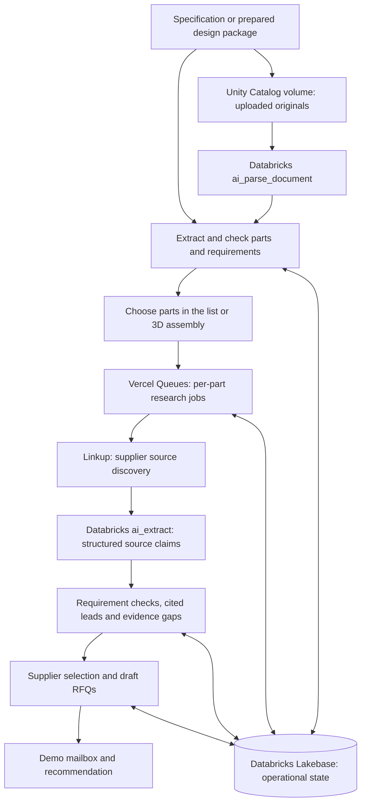
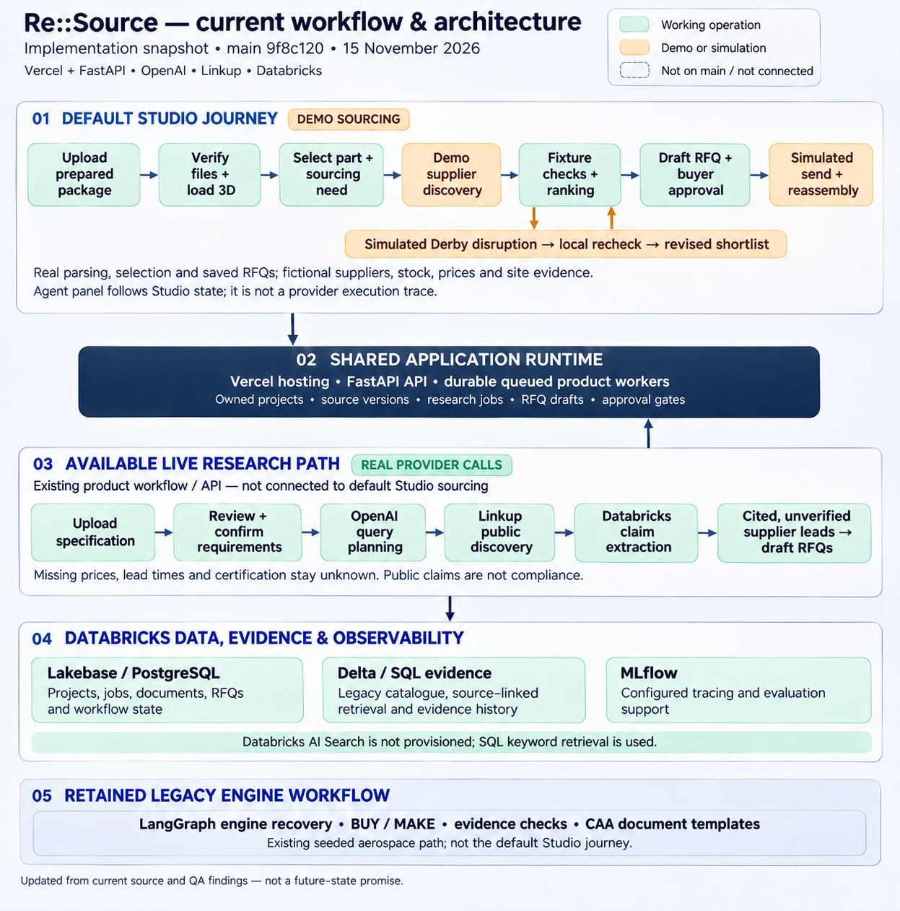

# Re::Source

**From blueprint to supplier shortlist. An AI sourcing workspace for engineering teams.**

Re::Source turns product specifications into a traceable sourcing workflow: identify the parts, check the requirements, investigate suppliers, compare the evidence, and prepare requests for quotation. Engineers can explore an assembly in 3D, select components, and follow the work through to a reviewable recommendation.

**Linkup supplies the external research. Databricks parses documents, extracts structured claims, and persists the work.** Their outputs drive the next sourcing action, with source references and explicit evidence gaps throughout.

[Open the application](https://resource-borbez2s-projects.vercel.app/) · [Source code](https://github.com/Borbezzz/Re-Source) · [Devpost submission copy](docs/submission/DEVPOST.md) · [Architecture](architecture.md)

Built for the **Imperial AI Hackathon, 14–15 November 2026**. Target track: **Autonomous Agents**. Target bounties: **Databricks** and **Linkup**.

## Why we built it

Finding a component involves more than finding a supplier's website. Someone has to read the drawing, distinguish part identifiers from drawing references, establish quantities and materials, compare capabilities, identify missing evidence, and turn the result into an actionable enquiry. That work is often spread across PDFs, browser tabs, spreadsheets and email.

Re::Source connects those steps. The agent advances routine research under a sourcing mandate, while the engineer retains the specification, the sources and the final purchasing decision. Aerospace recovery motivated the original evidence model; the product workflow also supports ordinary mechanical assemblies, including a toy car and a desk lamp.

## What it does

- **Accepts specifications and design packages.** Upload source documents or start with a prepared assembly. Original uploaded bytes retain a stable identity and durable storage location.
- **Proposes parts and requirements.** Extract names, quantities, explicit part numbers and technical requirements with source quotations. Missing or conflicting facts become review questions.
- **Makes assemblies navigable.** Inspect prepared or uploaded GLB geometry, explode and reassemble the model, and select parts through the scene or accessible lists. Projects can proceed without a model.
- **Investigates suppliers concurrently.** Selected parts have separate work, candidates and progress. Queued work can continue when the browser is closed.
- **Compares evidence against requirements.** Supplier findings retain source URLs and outstanding questions. Public claims do not establish certification, stock or quoted prices.
- **Prepares RFQs.** Draft enquiries contain the requested parts, quantities, specifications and missing evidence. The Studio enquiry form also captures delivery and buyer details.
- **Runs an autonomous demo workflow.** One start action can check grounded specifications, research parts, choose outreach targets, prepare requests, process labelled sample replies and produce a recommendation.
- **Persists and resumes work.** Investigations survive reloads. Specification edits invalidate dependent results so old jobs cannot publish against new requirements.
- **Retains a deeper recovery engine.** The original aerospace scenario compares BUY and MAKE routes, applies deterministic evidence gates, schedules and ranks plans, and reassesses affected decisions when evidence or simulated disruption signals change.

### Demo and live behavior

The prepared Studio/ZIP experience uses authored assembly data and sample offers. It **skips Linkup and Databricks AI Functions**; provider labels distinguish skipped stages from executed calls. Production persistence still uses Lakebase.

The live uploaded-specification path has recorded executions using OpenAI, Linkup and Databricks `ai_extract`. A separate real PDF execution used `ai_parse_document`. The built-in mailbox, sample replies, disruption replay and submission receipts are simulations. Real supplier email delivery and purchasing are not connected. Prepared geometry is visual context, not validated manufacturing CAD; automatic blueprint-to-3D generation remains a future integration.

## Architecture



The generic product agent uses persisted Python services and queued continuations. The retained engine recovery workflow uses **LangGraph**, with parallel BUY/MAKE sourcing and evidence checks. Both share the backend and operational store. The public application is hosted on Vercel; it does not use Agent Bricks as its runtime.



## Databricks: exact features used

Databricks is central to **document understanding, supplier evidence processing and durable agent state**. The retained recovery workflow adds Delta-backed evidence and decision projections.

### AI Functions: `ai_parse_document`

- Reads uploaded document bytes from the Unity Catalog volume `workspace.resource.rs_uploads`.
- Calls `ai_parse_document(content)` through the SQL warehouse, using `read_files(..., format => 'binaryFile')` to obtain binary content.
- Converts parsed document elements into text for parts extraction. The intake service also retains available page/element information for source locators.
- Records the actual extraction method on each product document, such as `databricks_ai_parse_document`.
- Was exercised on a real NASA turbine rotor blade-section PDF. OpenAI then proposed one named part and three requirements for review; the drawing identifier was not promoted to an OEM part number.
- Connects document parsing to the sourcing task while retaining the original file for inspection.

Implementation: [document worker](backend/recovery/services/product_workers.py), [intake and locators](backend/recovery/services/intake.py). Evidence: [recorded PDF result](docs/verification/product-workflow-20261115/nasa-blueprint.json). Platform reference: [Databricks `ai_parse_document`](https://docs.databricks.com/aws/en/sql/language-manual/functions/ai_parse_document).

### AI Functions: `ai_extract`

- **Supplier enrichment:** extracts `supplier_name`, `country`, `materials` and `certifications` from Linkup titles and snippets.
- **Batched execution:** groups documents by field-label set and processes up to 20 rows per SQL statement, with parameterized document values.
- **Literal grounding:** supplier identity and country are accepted only when present in the retrieved text. Requirement checks retain source URLs and remain `unknown` until supporting evidence establishes the requirement.
- **Recovery evidence:** a separate extractor produces typed facts with evidence-version IDs, extraction modes, validation state and available locators. It cross-checks generated output against explicit structured fields and caches facts by content hash/document type.
- **Failure handling:** optional extraction failure leaves original cited snippets visible without manufacturing supplier facts or recording a successful provider call.
- **Observed use:** connected shaft and M8 fastener investigations recorded `databricks_ai_extract`, `linkup` and `openai`, with six public leads in each recorded example.

The implemented SQL signature is **`ai_extract(text, array(field_labels...))`**. Source references, validation and confidence rules are application logic. We do not use the newer rich-schema or built-in citation/confidence options in the current [Databricks `ai_extract` API](https://docs.databricks.com/aws/en/sql/language-manual/functions/ai_extract).

Implementation: [SQL adapter](backend/recovery/adapters/databricks_sql.py), [supplier worker](backend/recovery/services/product_workers.py), [evidence extractor](backend/recovery/adapters/extractor.py). Evidence: [live product run](docs/verification/product-workflow-20261115/deployed-product.json), [autonomous live run](docs/verification/agent-outreach-20261115/staged-live.json).

### Lakebase: managed Postgres for durable agent state

- Stores visitor-owned projects, document metadata, research results, selections, RFQs, agent state, simulated mailbox records and job state.
- Stores **LangGraph Postgres checkpoints** for the retained recovery graph, enabling persisted progress to resume on job redelivery.
- Supports transactional state changes and job intent, with dispatch after commit and revision checks before publishing results.
- Uses persisted job records and **Postgres advisory locks** to protect against overlapping queue deliveries; command idempotency protects repeated application requests.
- Obtains short-lived database credentials through the Databricks SDK. The token provider caches and refreshes credentials; SQLAlchemy recycles connections.
- Keeps work durable across Vercel invocations. The public serverless application refuses to start with temporary SQLite storage.
- Was observed in connected live and demo runs reporting `lakebase_postgres`. A staged demo completed while its verifier made no reads for 60 seconds.

Implementation: [operational store](backend/recovery/adapters/store.py), [credentials](backend/recovery/adapters/lakebase.py), [durable jobs](backend/recovery/runtime/jobs.py). Evidence: [autonomous verification](docs/verification/agent-outreach-20261115/REPORT.md). Platform reference: [Databricks Lakebase](https://docs.databricks.com/aws/en/oltp/projects).

### Unity Catalog Volumes: durable original documents

- Stores uploads under `/Volumes/workspace/resource/rs_uploads/` using **SHA-256 content-addressed filenames**.
- Uses the Databricks SDK Files API for upload/download and SQL to check or create the volume.
- Treats local disk as a cache, retrieving originals from the volume after a serverless instance disappears.
- Validates volume paths and retains document ownership at the application boundary.
- Requires successful durable mirroring before acknowledging a serverless upload. The application currently limits uploads to **4 MB**.

Implementation: [blob store](backend/recovery/adapters/blob_store.py), [deployment contract](deploy/vercel/README.md).

### Delta and Databricks SQL: the recovery evidence layer

- Defines **16 `rs_*` Delta tables** in `workspace.resource`: evidence versions, facts, relationships, requirements, offers, suppliers, sites, routes, reliability metrics, signals and six decision/action projection tables.
- Uses idempotent `MERGE` ingestion with SQL parameters and explicit source revisions.
- Projects committed recovery decisions, checks, selections, document packages, receipts and changes through an outbox-driven worker.
- Provides keyword retrieval over Delta evidence, with exact-ID resolution for authoritative decision checks.
- Enables Change Data Feed on `rs_evidence_versions` in the schema for future indexing. No AI Search/Vector Search endpoint is provisioned.

These tables serve the retained recovery scenario. Its seeded companies, offers and reliability metrics are synthetic. Generic product state lives in Lakebase; every product record is not automatically projected into Delta.

Implementation: [schemas and projections](backend/recovery/services/projection.py), [ingestion](data/ingestion/README.md), [retrieval](backend/recovery/adapters/search.py).

### MLflow 3: implemented diagnostics and recorded evaluations

- Implements named agent-operation spans and optional OpenAI autologging to a Databricks experiment.
- Includes scorers for mandatory gates, unsupported eligibility, citation/version integrity, ranking, change impact, duplicate effects and form-field accuracy.
- Records a 17-row synthetic domain evaluation, including six held-out scenarios.
- Separates diagnostic tracing from application events; tracing initialization does not gate HTTP startup.

**Status:** implemented and previously exercised, but current public tracing is disabled. The production check on 15 November confirmed an active experiment with tracing disabled. See [tracing code](backend/recovery/runtime/tracing.py), [evaluation evidence and limits](tests/evaluations/README.md), and [submission verification](docs/submission/VERIFICATION.md).

### Newer capability highlights

The strongest supported highlights are **AI document parsing, SQL-native AI extraction and Lakebase-backed agent persistence**, composed with Unity Catalog source storage. This build does not demonstrate Lakebase branching/autoscaling controls, the newest `ai_extract` citation API, Lakeflow AI Function tasks, Genie or Agent Bricks hosting. Databricks Apps was exercised earlier; the public frontend and API now run on Vercel.

## Linkup: exact features used

Linkup is the live supplier-discovery step. Its sources become inputs to Databricks extraction, requirement checks, supplier candidates and RFQ evidence requests.

### Search API and execution

- **Endpoint:** server-side `POST https://api.linkup.so/v1/search` with bearer authentication.
- **Mode:** `depth: "standard"`. Linkup documents this as single-iteration agentic search, able to interpret queries and perform sub-searches. We do not inspect or claim a particular internal search sequence. See [Linkup Search](https://docs.linkup.so/pages/documentation/endpoints/search/overview).
- **Output:** `outputType: "searchResults"`; `name`, `url` and `content` become titles, source URLs and snippets.
- **Grounded queries:** terms derive from the confirmed component name, explicit part number and requirements. OpenAI can propose up to two concise queries; a deterministic query is available otherwise.
- **Bounded work:** default 25-second request timeout; the worker takes up to four results per query, deduplicates URLs and retains up to six sources per part. Result limits are applied locally, not sent as Linkup's `maxResults` parameter.
- **Concurrent parts:** separate queued workers investigate parts concurrently; the searches within an individual part's worker are sequential.
- **Caching and diagnostics:** successful queries are cached within the process; the adapter records retrieval time, latency, call counts and failures. This cache is not a persistent freshness guarantee.

### From sources to actions

- Keeps original URLs attached to candidates and requirement-level evidence notes.
- Rejects malformed or credential-bearing URLs before creating candidates.
- Feeds source titles/snippets into Databricks `ai_extract`, accepting supplier identity and country only when literally supported.
- Marks findings `public_web` and `unverified`. Unknown prices, stock, delivery dates and certification stay unknown.
- Turns evidence gaps into explicit questions in the RFQ.
- Records actual `providers_used` per investigation. Failed live discovery does not substitute fictional demo offers.

**Observed use:** the connected product run returned six cited supplier leads. The autonomous M8 fastener run reached RFQ drafting before requesting verified recipient/mailbox details. Both recorded real Linkup and Databricks extraction. See [product run](docs/verification/product-workflow-20261115/deployed-product.json) and [autonomous run](docs/verification/agent-outreach-20261115/staged-live.json).

**Feature scope:** the build uses standard search results. It does not call Deep, Flash/Fast, Fetch, Research, Tasks, Extract, `sourcedAnswer` or schema-constrained `structured` output. The bounty case is the depth of integration into sourcing decisions, not an unimplemented newer endpoint.

Implementation: [Linkup adapter](backend/recovery/adapters/external.py), [research pipeline](backend/recovery/services/product_workers.py).

## Complete technology stack

| Area | Technology | Specific role |
| --- | --- | --- |
| Interface | React 19, TypeScript, Vite | Typed workspace, project navigation, API client and production build. |
| 3D | Three.js, React Three Fiber, Drei, glTF/GLB | Assembly rendering, selection, camera controls and exploded views. |
| Assets | Blender/glTF tooling; licensed prepared models | Prepared geometry and mesh-to-part mappings; not automatic CAD generation. |
| Motion/graphics | Anime.js, Motion, OGL, CSS | Wordmark, visual effects and transitions. |
| Map | D3 Geo, TopoJSON Client, World Atlas | Geographic projection, country geometry and supplier markers. |
| UI utilities | Lucide React, Geist/Geist Mono, fflate | Icons, self-hosted fonts and ZIP package handling. |
| API | Python 3.12, FastAPI, Uvicorn, Pydantic | HTTP services, validation, typed contracts and OpenAPI. |
| Model | OpenAI SDK / Responses API | Structured extraction, query planning and explanations; configurable model, default `gpt-5.4-mini`. |
| Orchestration | Python services, LangGraph, Postgres/SQLite checkpoint packages | Product continuations and retained recovery investigation/reassessment. |
| Databricks | AI Functions, SQL, Unity Catalog, Delta, Lakebase | Parsing, extraction, durable sources, state and recovery evidence. |
| Search | Linkup REST API via HTTPX | Live supplier research with original source URLs. |
| Database access | SQLAlchemy, Psycopg, Psycopg Pool; SQLite locally | Transactions, PostgreSQL access, pooling and local development. |
| Hosting/jobs | Vercel Services, Vercel Queues | Public frontend/API and durable Python workers. |
| Scheduling | Google OR-Tools CP-SAT, Python critical-path calculations | Capacity-constrained BUY/MAKE recovery plans. |
| Document/config utilities | pypdf, python-multipart, JSON, PyYAML, python-dotenv | PDF fallback, uploads, fixtures, requirements and configuration. |
| Registry | UK Companies House API | Optional recovery-workflow legal-entity lookup; not certification. |
| Diagnostics | MLflow 3, application events | Optional traces, recorded domain evaluation and visible progress. |
| Testing/tooling | pytest, pytest-asyncio, Ruff, Node test runner, Playwright, TypeScript, Prettier, uv, npm, Git/GitHub | Automated verification, linting, dependencies and collaboration. |
| Design reference | Figma | Shared design source linked from the [frontend README](frontend/README.md). |

Dependency declarations: [backend](backend/pyproject.toml), [Vercel runtime](pyproject.toml), [frontend](frontend/package.json). Lockfiles preserve resolved versions.

## Reliability and evidence design

- **Grounding:** document references must belong to the project and support the asserted value. A default quantity is not source evidence.
- **Revision-aware work:** workers carry their input version. Changes invalidate downstream research, selections and packages.
- **Durable continuations:** queue messages identify persisted jobs; transactions and duplicate-delivery controls support restart recovery.
- **Bounded execution:** the Vercel subscriber is configured for three concurrent deliveries, five attempts and a 300-second function budget. Local development uses threads.
- **Reviewable authority:** models extract and explain; deterministic rules decide recovery eligibility. Generic public-web leads remain unverified.
- **Provenance:** fixtures, public sources, extracted claims, human review and agent checks remain distinguishable.
- **Visitor isolation:** an opaque visitor cookie scopes public demo projects and runs; it is not authenticated engineering approval.

## Run locally

### Prerequisites

Python **3.12**, [uv](https://docs.astral.sh/uv/), and Node.js/npm compatible with the committed frontend dependencies. Development verification used Node **26.12.1**. No provider keys are needed for the prepared offline demo.

### Backend: offline demo

From the repository root:

```bash
cd backend
uv sync
PYTHON_DOTENV_DISABLED=1 \
RS_MODEL_ENABLED=false RS_DATABRICKS_ENABLED=false \
RS_LINKUP_ENABLED=false RS_COMPANIES_HOUSE_ENABLED=false \
RS_TRACING=false RS_PREWARM=false RS_DELTA_PROJECTION=false \
RS_USE_LAKEBASE=false RS_OPERATIONAL_DB_URL= RS_JOB_BACKEND=thread \
uv run uvicorn recovery.api.app:app --reload --port 8000
```

This uses committed fixtures, SQLite and local workers. It does not demonstrate live sponsor calls. The overrides prevent a local `.env` from enabling providers.

### Frontend

In a second terminal, from the repository root:

```bash
cd frontend
npm ci
npm run dev
```

Open [the local application](http://127.0.0.1:5173). Vite proxies `/api` to port 8000. For another backend port, set `RS_API_TARGET=http://127.0.0.1:8001` when starting Vite.

### Connected development

Copy `.env.example` to `.env` at the repository root, configure the intended integrations and start the backend without the offline overrides.

| Settings | Purpose |
| --- | --- |
| `OPENAI_API_KEY`, `OPENAI_MODEL` | Model calls and query planning. |
| `LINKUP_API_KEY` | Live supplier discovery. |
| `DATABRICKS_HOST`, `DATABRICKS_HTTP_PATH` or `RS_WAREHOUSE_ID`, `DATABRICKS_TOKEN` | SQL/AI Functions and volume access. OAuth client credentials are also supported. |
| `DATABRICKS_CATALOG`, `DATABRICKS_SCHEMA` | Default `workspace` and `resource`. |
| `PGHOST`, `PGUSER`, `PGDATABASE`, `RS_USE_LAKEBASE=1` | Lakebase connection; optional `PGPORT`/`PGSSLMODE` default to 5432/require. |
| `RS_LAKEBASE_INSTANCE`, `RS_LAKEBASE_SCHEMA` | Default `resource-ops` and `resource_ops`. |
| `MLFLOW_TRACKING_URI`, `MLFLOW_EXPERIMENT_ID`, `RS_TRACING` | Optional tracing. |
| `COMPANIES_HOUSE_API_KEY` | Optional registry lookup. |

Credentials stay on the backend. The configured identity needs warehouse, volume and database access. Public deployment requires durable storage; Preview does not automatically inherit Production credentials. See [Vercel deployment](deploy/vercel/README.md) and [retained Databricks App notes](deploy/databricks/README.md).

Delta ingestion is separate from startup. From `backend/`, preview it with `uv run python ../data/ingestion/load_delta.py --dry-run`; see [the loader documentation](data/ingestion/README.md) before executing connected writes.

## Verification

The production check at **10:54 GMT on 15 November 2026** reported healthy Lakebase/Postgres, a working SQL warehouse and `ai_extract` probe, all 16 Delta tables, Postgres checkpoints and synchronized evidence. Linkup was configured; that check did not run a new Linkup search. [Details and limitations](docs/submission/VERIFICATION.md).

Recorded test milestones, at the revisions identified in each report:

- [Product workflow](docs/verification/product-workflow-20261115/REPORT.md): 226 backend and 18 frontend tests; connected upload, parallel jobs, Lakebase, Linkup, `ai_extract` and NASA PDF parsing.
- [Autonomous sourcing](docs/verification/agent-outreach-20261115/REPORT.md): 265 backend and 20 frontend tests; one-start demo, unattended queued completion, and live RFQ drafting stopping at missing contact information.
- [Provider provenance](docs/verification/provider-workflow-2026-11-15.md): 30 frontend tests plus desktop/mobile ZIP-to-RFQ journeys, including skipped-provider labels.
- [Domain evaluation](tests/evaluations/README.md): 17 synthetic scenarios with independent expectations. This evaluates domain logic, not arbitrary-drawing extraction accuracy.

Run the existing suites:

```bash
# From backend/
PYTHON_DOTENV_DISABLED=1 RS_SKIP_DATABRICKS=1 uv run pytest ../tests -q

# From frontend/
npm run build
npm test

# With the local backend and frontend running:
npx playwright test
```

For a sponsor demonstration, show a **live-mode uploaded-specification investigation**, its actual `providers_used`, citations and resulting RFQ. Separately show the document's actual parsing method. A prepared ZIP demonstrates interaction and orchestration, but skips external research/extraction.

## Repository guide

```text
backend/recovery/
  api/          FastAPI endpoints
  adapters/     Databricks, Lakebase, Linkup, OpenAI, storage and parsing
  agents/       LangGraph recovery graph and tools
  domain/       Contracts, rules, ranking and scheduling
  runtime/      Durable jobs, events, tracing and visitor context
  services/     Product workflow, intake, decisions, documents and changes
frontend/       Workspace, assembly scene, map and agent workflow
contracts/      Generated JSON Schema, OpenAPI and TypeScript
data/           Demo products, profiles, fixtures and Delta loader
rules/          Versioned recovery requirements and ranking
templates/      Recovery document registry and renderers
deploy/         Vercel and retained Databricks notes
tests/          Unit, integration, end-to-end and domain evaluations
docs/           Product decisions, verification, diagrams and submission copy
```

Further reading: [current product](docs/product-v2/DEMO-AND-LIVE.md), [autonomy/mailbox contract](docs/product-v2/AGENT-OUTREACH.md), [API contract](interface.md), [decisions](decisions.md), [status](status.md), [original recovery PRD](PRD.md).

## Next steps

- Connect an authorized test mailbox with verified recipients and durable reply/delivery reconciliation.
- Incorporate real quotations and documentary evidence into comparisons.
- Expand extraction evaluation across drawings, assemblies and ambiguous specifications.
- Add automatic 3D reconstruction only with useful geometry provenance and validation.
- Extend live monitoring/reassessment and evaluate newer search/extraction APIs against measured sourcing outcomes.

## Attribution and collaboration

Prepared assets retain licenses and credits in [`frontend/public/models/licenses/`](frontend/public/models/licenses/). The Mechanica-derived turbofan is attributed to Pouyan Jahangiri / PouyanJay under MIT; see [asset attribution](frontend/public/models/licenses/mechanica-ATTRIBUTION.md). Asset licensing does not imply engineering validation or a repository-wide license.

Team coordination uses [message board issue #1](https://github.com/Borbezzz/Re-Source/issues/1), [`tools/board`](tools/board), and [`AGENTS.md`](AGENTS.md). Each agent reader needs its own ID; read the contribution rules before contributing.
