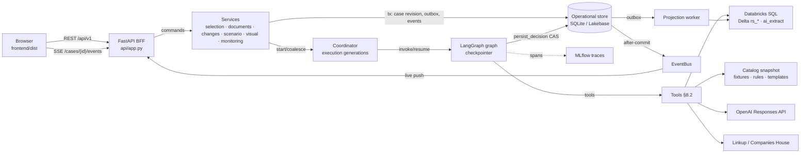
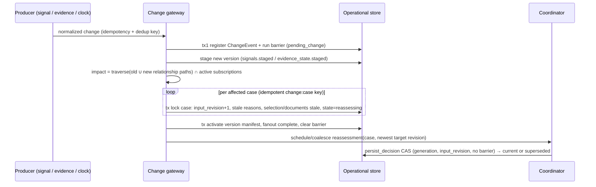
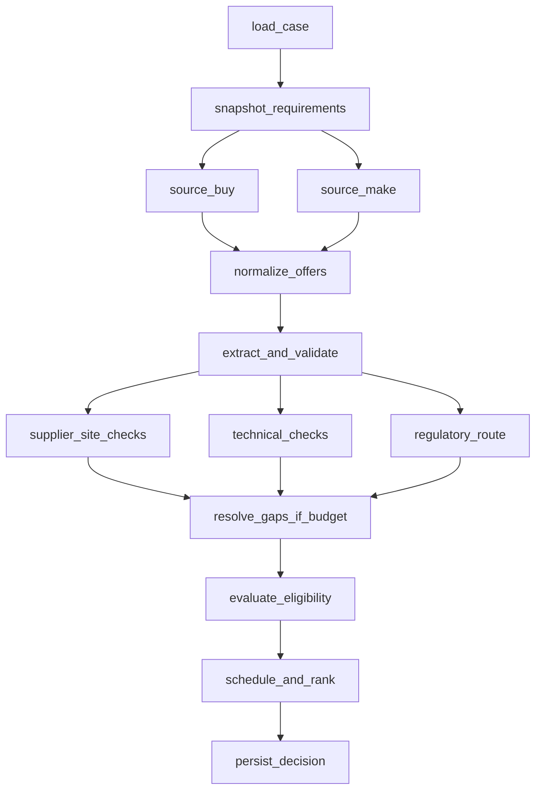
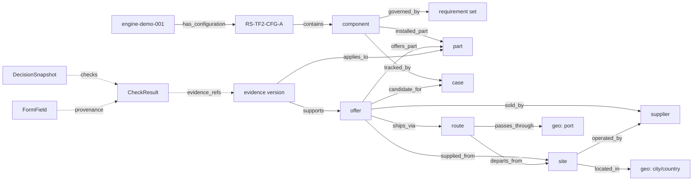

# Re-Source — architecture (as implemented)

This describes what the code actually does. Where it departs from PRD §5, see the referenced decision in [`decisions.md`](decisions.md). Module status is tracked in [`status.md`](status.md).

## 1. Layers

| Layer | PRD default | Implemented | Notes |
|---|---|---|---|
| Frontend | React + TS + Vite | Delegated to Borbezzz's OpenAI agent (`frontend/**`) | D-013. Built against `contracts/` and [`interface.md`](interface.md). |
| 3D | R3F + drei, glTF | Procedural R3F geometry or licensed GLB; node names from the manifest | D-009. |
| API/BFF | FastAPI + Pydantic | `backend/recovery/api/app.py` | Serves `frontend/dist` at `/` in deployment. |
| Orchestration | LangGraph | `backend/recovery/agents/graph.py` + `investigation.py` | One graph for investigation and reassessment. |
| Agent hosting | Agent Bricks / AgentKit / Agent Runtime | Background workers in the FastAPI process (Databricks App `resource`) | D-006 gap. |
| Models | Claude via Databricks | OpenAI Responses API, `OPENAI_MODEL` (default `gpt-5.4-mini`) | D-001/D-002. Explains only. |
| Evidence/data | Delta + UC + SQL warehouse | Delta tables `workspace.resource.rs_*` loaded from fixtures; SQL warehouse | D-014. |
| Retrieval | AI Search hybrid + rerank | Exact-ID resolution for gates; keyword search fallback; mode recorded | D-008. |
| Operational storage | Lakebase Postgres | `OperationalStore`: Postgres-ready, SQLite locally | D-004. |
| Execution state | Runtime Store + checkpoints | LangGraph SqliteSaver (PostgresSaver with Lakebase) | D-005. |
| Ingestion | Lakeflow jobs | `data/ingestion/load_delta.py`; signal/evidence/clock ingestion through the change gateway | Scheduled Lakeflow job: future. |
| Document AI | ai_parse_document + ai_extract | `ai_extract` via SQL, cross-checked with the structured parse | D-007. |
| Observability | MLflow 3 | `runtime/tracing.py` → experiment `/Shared/ReSource/agent-traces` | Events carry `trace_id`. |
| External discovery | Linkup | `adapters/external.py` (Linkup, Companies House) | D-012. |
| Scheduling | Python + OR-Tools | `domain/scheduler.py` (CPM; CP-SAT for capacity windows) | |

## 2. Request and event flow

- Commands commit to the operational store. Domain events are written **in the same transaction** with a per-case `sequence` and pushed to SSE subscribers only **after commit** (`store.after_commit`).
- Long work (investigations, reassessments) returns `202` with a command/generation ID and runs in background workers. Concurrency is bounded by `RS_MAX_CASE_WORKERS`, and every run has a tool budget (`RS_RUN_TOOL_BUDGET`).
- Outbox items (`project_decision`, `project_selection`, `project_receipt`, `generate_documents`, …) drive side effects and analytical projections into Delta, with idempotent consumers. Each item records attempts, `last_error` and its source revision.

## 3. Storage authority (PRD §5.3)

| Data | Authority | Where |
|---|---|---|
| Case revision, input revision, state, visual state, monitoring | Operational store | `cases` |
| Commands / idempotency keys | Operational store | `idempotency` |
| Domain events (per-case sequence) | Operational store | `events` |
| Decisions (immutable payloads), diffs | Operational store (+ Delta projection) | `decisions`, `diffs` → `rs_decision_snapshots`, `rs_check_results` |
| Selections, packages/drafts (immutable versions + current pointers), receipts | Operational store | `selections`, `packages`, `drafts`, `receipts` |
| Barriers, change events, subscriptions, generations, timers, gaps | Operational store | same-named tables |
| Run evidence version manifest / follow-ups | Operational store | `evidence_state` (overlay on the catalog) |
| Immutable evidence versions, facts, relationships, requirements | Delta (`rs_*`) and the versioned fixture files they are loaded from | `data/fixtures/seed-v1`, `rules/`, `templates/` |
| Extraction cache (dedup by content hash) | Operational store | `facts_cache` |
| Graph progress | Checkpointer | `var/checkpoints.sqlite3` (or Postgres) |
| Diagnostic traces | MLflow | experiment `2648868221488633` |

A decision binds `input_revision`, `evidence_set_id`/`evidence_hash`, `requirements_version`, `ranking_config_version`, and signal/relationship versions.

## 4. Change activation protocol (PRD §5.3.1, D-016)

- **Barrier:** selection, current-decision publication and simulated submission lock the run row and refuse while `barrier_count > 0`.
- **Coalescing:** one active generation per case. A newer target revision is recorded in `pending_target_revision` and picked up when the current generation finishes. Older generations finish but are stored as `superseded`, with no `decision.updated` event (AC-19).
- **Timers:** future-effective signals, signal expiry and evidence expiry register `timers`. `POST /scenario-runs/{id}/clock` advances the scenario clock and fires due timers through the same gateway (AC-21).
- **Paused monitoring:** fan-out records pending changes on paused subscriptions, and resume reconciles them before the case becomes selectable.
- **Run isolation:** reset creates a new run namespace and pauses the previous run's subscriptions. Signal injection targets one run.

## 5. Agent graph (PRD §8.1)

- Workers return typed patches. Reducers merge by candidate/check ID (`offers`, `docs`, `facts`, `checks`, `gaps`, `tasks`), and `tool_usage` is summed.
- **Reassessment** runs the same graph with `affected_candidate_ids`. Unaffected candidates reuse prior checks, plans and exposure by reference (`reused_from_decision_id`). Affected checks whose fingerprint is unchanged are also marked reused. The DecisionDiff lists rerun versus reused check IDs.
- **Gap follow-up (FR-05):** mandatory unknowns with a gap trigger `request_supplier_followup` through the seeded supplier-reply connector, up to `RS_FOLLOWUP_ATTEMPTS` (2) per candidate. New evidence is activated for that candidate, extracted, and the affected checks are rerun.
- **Selection path:** `revalidate_selection → plan_documents → autofill → validate_package → await_review → simulate_submission`, implemented as services and outbox steps rather than graph nodes.

## 6. Evidence graph (FR-11)

Impact traversal (`domain/impact.py`) walks from the changed entities to cases: geo ← passes_through/located_in, route ← ships_via, site ← supplied_from, supplier ← sold_by, part ← offers_part, evidence → supports/applies_to, offer → candidate_for. Each reached (start, case) pair yields a displayable impact path, for example `GEO-PORT-NLRTM → R-RTM-HWC → OFF-PA → case-primary`.

## 7. Module map (`backend/recovery/`)

| Module | Responsibility |
|---|---|
| `config.py` | Settings from env / `.env`; feature flags; paths (`var/` for local state). |
| `domain/models.py` | Canonical Pydantic contracts (entities, events, API). |
| `domain/catalog.py` | Loads manifest, fixtures, requirement sets (template expansion), ranking, applicability and templates. |
| `domain/extraction.py` | Field schemas per doc type, structured parser, code validation/coercion. |
| `domain/rules.py` | `CandidateContext`, 13 evaluators (identity, interchangeability, release certificate, traceability, site QMS, legal entity, quote, POA, design data, special process, FAI, route viability, regulatory route), fingerprints, eligibility gates. |
| `domain/scheduler.py` | Plans: CPM, CP-SAT capacity windows, signal-adjusted transport, FX-converted cost lines, exposure. |
| `domain/ranking.py` | FR-08 normalisation and score, tie-breaking, evidence coverage. |
| `domain/impact.py` | Relationship graph and impact paths. |
| `domain/documents.py` | Applicability → package, field autofill/provenance, readiness (documents fork). |
| `domain/errors.py` | `DomainError` → error envelope. |
| `adapters/store.py` | Operational store, transactions, events, idempotency, facts cache. |
| `adapters/model_client.py` | OpenAI Responses API with structured outputs and deterministic fallbacks. |
| `adapters/databricks_sql.py` | SQL warehouse (token or service principal OAuth), `ai_extract` batches, probes. |
| `adapters/extractor.py` | DocumentExtractor (D-007). |
| `adapters/external.py` | Linkup and Companies House. |
| `adapters/search.py` | EvidenceSearch (data-layer fork). |
| `adapters/renderer.py` | DocumentRenderer: reviewable HTML package (documents fork). |
| `runtime/events.py` | EventBus: transactional append, after-commit SSE fan-out. |
| `runtime/tracing.py` | MLflow tracing init, spans, trace IDs. |
| `agents/tools.py` | PRD §8.2 tools: events, spans, budget. |
| `agents/investigation.py` | Graph node implementations. |
| `agents/graph.py` | StateGraph, reducers, checkpointer. |
| `services/run_state.py` | Run overlay: clock, evidence manifest, follow-ups, active signals, run relationships. |
| `services/*` (in progress) | container, coordinator, changes, decisions/diff, selection, documents, scenario, visual, monitoring, projection, readiness. |
| `api/app.py` (in progress) | FastAPI routes, SSE, error envelope, idempotency, static frontend. |

Repository layout follows PRD §14: `frontend/`, `backend/`, `contracts/`, `data/`, `rules/`, `templates/`, `deploy/`, `tests/`, `docs/`.

## 8. Security and data handling

- Server credentials stay server-side. The browser only talks to the BFF (PRD §11).
- Source documents are untrusted data. Extraction prompts tell the model to ignore embedded instructions, and the tools enforce domain transitions.
- All SQL is parameterised. The only interpolated SQL fragments are code constants (field labels).
- Every fixture entity carries `data_origin: synthetic_demo`, and favourable reliability values are labelled as scenario fixtures.
