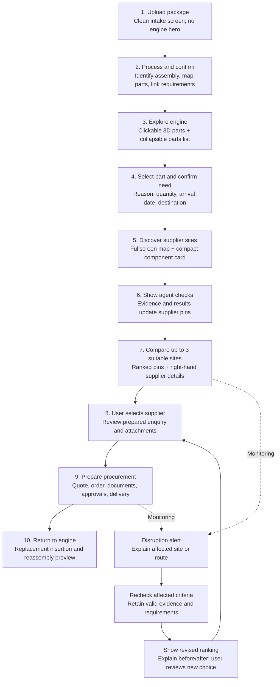

# Re::Source — Design Flow

**Purpose:** Help a manufacturer replace a jet-engine component by finding a suitable supplier and preparing the procurement process.

## High-level journey

**Upload design package → Explore engine → Select component → Find and check suppliers → Choose supplier → Prepare procurement → Preview reassembly**

## User inputs

Use the previously agreed design package. Extract information from the files and ask the user to confirm only essential gaps or conflicts.

| When | What the user provides |
|---|---|
| **Upload** | **CAD assembly or prepared matching model**, **parts list/BOM** with component identities and revisions, and **controlled drawings/specifications with applicable acceptance requirements**. |
| **After selecting a component** | **Reason** (faulty part/change supplier), **quantity** (default 1), **required on-site arrival date**, and **delivery location** (prefilled where known). |
| **Before supplier outreach** | Confirm manufacturer identity and contact details from the company profile. |
| **Before order commitment** | Confirm purchasing approval and billing details. |

Default to the same approved part and revision. Manufacture-to-specification or substitution requires its additional technical requirements and acceptance steps.

## Screen flow

## What the agents check and show

- **Checks:** Part/revision match, site qualification, supporting documents, availability, delivery feasibility, commercial fit and operational risk.
- **Candidate states:** Eligible, awaiting verification or excluded. Show the evidence and reason; missing evidence remains unresolved.
- **Supplier panel:** Site, recommendation, qualification evidence, price, availability, delivery, risks and outstanding questions. Distinguish estimates from supplier confirmations.
- **Disruption:** Highlight the affected path, show the checks being repeated and explain the changed recommendation. Invalidate affected approvals; committed orders need a change process.

## Outputs

1. **Interactive assembly** linked to component identities and requirements.
2. **Supplier shortlist and selected supplier**, with evidence and decision history.
3. **Procurement package:** RFQ, quotation status, draft order, quality/traceability documents or requests, applicable approval paperwork, and delivery plan with remaining actions.
4. **Reassembly preview**, with engineering acceptance and delivery readiness shown separately.

## Design and demo rules

Quiet premium industrial styling: charcoal, offwhite typography, generous space, restrained controls. Keep the map visible during checks and the component card consistent throughout. Start with one detailed component case plus two additional selectable cases.

The demo processes a prepared package and reveals its matching model. External communications and submissions are simulated and labelled. Procurement states remain explicit: prepared, approved, sent, acknowledged or confirmed. Regulatory forms depend on the transaction; supplier-issued certificates are requested, not fabricated. Visual reassembly does not establish engineering acceptance.
