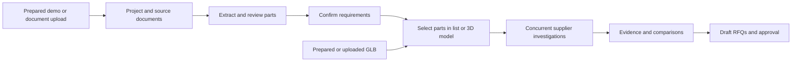

# ReSource: demo and real product workflow

Implementation target, 15 November 2026. This resolves the earlier product-flow
draft using Yixin's direction: product-agnostic assemblies, several prepared demo
models, reviewed requirements, parallel research and a concrete decision output.

## What the demo demonstrates

Choose a toy car, turbofan engine or table lamp. Each project owns its parts,
documents, model, research and decisions. Review the authored sample specification,
select several parts, run research, compare candidates and prepare an RFQ package.
Approving the package authorizes a simulation only. It does not place an order,
contact a supplier or certify a part.

Models are licensed, prepared assets. Demo specifications, prices, lead times and
suppliers are explicitly synthetic examples. Mesh groups provide selection and
exploded presentation; they do not prove dimensions, material or compatibility.
Source credits are recorded in the profiles and public model license files.

## How a real blueprint enters the backend

1. Create a visitor-owned project and upload a drawing or specification. Store
   original bytes durably and retain the document identity.
2. Parse document text (Databricks when configured), then propose parts and
   requirements. Keep source quotes attached. Missing facts require review;
   drawing numbers are not automatically manufacturer part numbers.
3. Review the proposed parts, quantities and requirements. Human edits remain
   distinguishable from quoted document facts. Confirmation creates the input
   revision used for research.
4. Attach a segmented GLB if one is available and map named mesh nodes to parts.
   The part list remains usable without a model. Uploaded models have their own
   provenance; they are not described as generated geometry.
5. Investigate selected parts concurrently. Linkup provides public discovery and
   citations in live research. Candidates remain unverified until supporting
   evidence establishes the required facts. Never invent quoted prices, delivery
   dates, exact locations or certification from a supplier's marketing page.
6. Compare findings, select candidates and produce draft RFQs with the reviewed
   requirements and outstanding evidence gaps. Preserve the human approval gate.

Automatic blueprint-to-3D reconstruction is a future provider boundary. The app
must return a clear unavailable state until an actual provider can produce a model
and its provenance. A plausible rendered shape is not automatically an accurate,
dimensioned CAD assembly. No demo asset may be returned as an alleged generation.

## Hackathon alignment

The initial hackathon handoff selected **Autonomous Agents** as the main track and
**Databricks** and **Linkup** as the two bounties. Later chats superseded the original
Claude/Databricks Apps hosting proposal with **OpenAI and Vercel**, while retaining
Databricks. This implementation follows those later decisions. Figma was an
optional design-prize possibility, not a confirmed additional bounty entry.

| Technology | Meaningful role |
| --- | --- |
| OpenAI | Structured extraction and evidence-aware research summaries when configured. |
| Databricks | Document parsing/storage and Lakebase operational persistence; existing Delta evidence, MLflow diagnostics and engine workflow remain available. |
| Linkup | Actual supplier discovery with public source citations in live research. |
| Vercel | Frontend/API hosting and durable queued work; provider calls stay on the server. |
| Blender / glTF | Licensed prepared assembly assets and named selectable visual groups. |

Use actual provider results and execution logs for the sponsor demonstration.
Configuration alone does not prove an integration ran. The deterministic demo
remains useful without external services, and is labeled as sample data.

## Integration rules

- Generic projects use additive `/api/v1/products` contracts. Do not mutate the
  global legacy engine catalog to fit an uploaded product.
- Persist visitor ownership, inputs, job state and results. Production jobs use
  the durable queue and publish only against the input revision they researched.
- Editing the specification invalidates dependent research, selections and RFQs.
- Separate quoted source facts, user-confirmed requirements, public leads and
  synthetic demo offers. A review confirmation is not supplier verification.
- Revalidate uploaded source references and model mappings before activation.
- Commit requirement changes atomically, then dispatch workers after commit.

Context used: the original hackathon handoff in “Continue ReSource hackathon
handoff”, its later product-agnostic/Blender decisions, and “Map backend flow and
test blueprint”. The latter's findings cover nonexistent source references,
confirmation retry behavior, extraction grounding and mobile header overlap.
