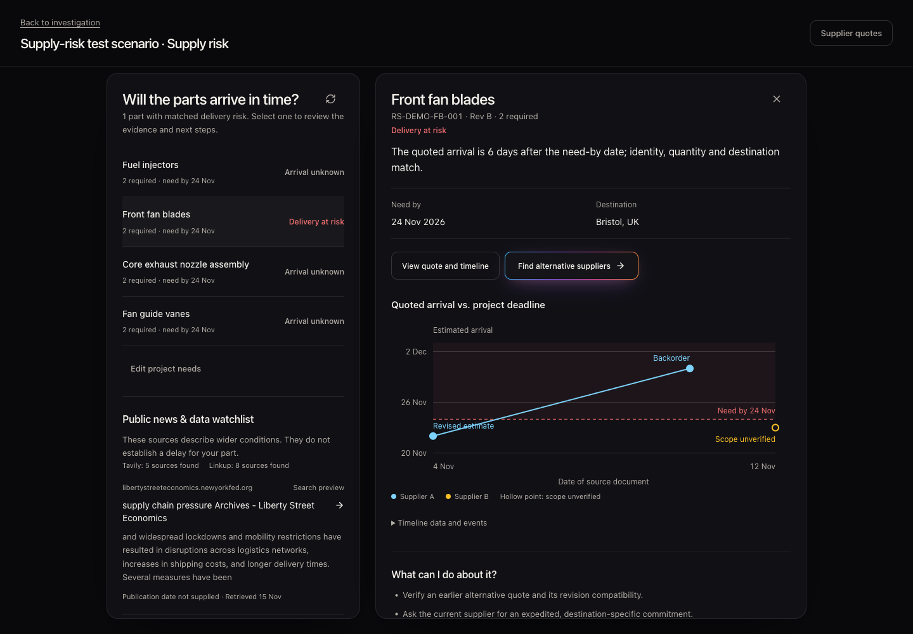
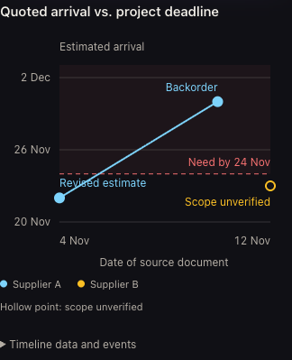
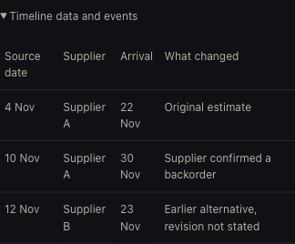

# Supply-risk scan verification — 15 November 2026

The scan follows confirmed parts, revisions, purchase quantities, destination and need-by date. Studio selection opens part-specific evidence, an arrival/deadline timeline, and alternative-supplier actions. Saved scans reopen at `#risk/{project_id}`. Imported quotes are reassessed on read; visible pages check every 20 seconds, on focus and when the quote dialog closes. Delivery evidence can be recorded in the panel.

Public context uses Tavily and Linkup with a generic query and primary-source domain restrictions. Live local verification returned 5 Tavily and 8 Linkup results before deduplication. Public trends remain a watchlist. Route alerts require matching current shipment evidence; synthetic, expired or unverified evidence cannot establish an alert. Unknown dates and revisions remain visible.

## Executed checks

- Backend: `./.venv/bin/python -m pytest ../tests -q` — **308 passed, 4 skipped**. Includes 38 supply-risk checks for identity/scope, tenant boundaries, stale versions, source persistence, actual quote import, provider privacy, expiry supersession, receipts and synthetic evidence.
- Frontend: `npm run build` and `npm test` — production build succeeded; **25 tests passed**. Existing large-bundle warnings remain.
- Chromium journeys: **7 passed** across `all-part-sourcing`, `selection-callout` (desktop/mobile), `supplier-quotes` (2), `supply-risk-state` and `supply-risk`. Six passed together; the last passed on rerun after fixing a test locator for a collapsed table. The state check retains an edited draft across a newer background snapshot, rejects its stale submission with 409, reopens the current project and edits successfully after an evidence update.
- Browser command: `RESOURCE_BASE_URL=http://127.0.0.1:5175 RESOURCE_BROWSER_CHANNEL=chromium RESOURCE_HEADED=1 npx playwright test <files>`. Full Chromium was used because the default software renderer saturated CPU on the complete assembly. Missing full-browser binaries were installed with Playwright; no application fallback was added.
- Final captures: desktop 1440×1000 and mobile 390×844. Complete chart and expanded data table fit their visible parent; no horizontal overflow or page errors. SVG widths match 630/324px; all three plotted points match their line coordinates with zero endpoint error.
- Fresh Astra API review: **Ship**, all six original findings resolved. This was a targeted code/image verdict, not whole-surface certification. The separate documentation pass preserved incumbent system files and recorded pre-existing DESIGN/Studio drift without repairing it.

## Preview evidence

Quotes shown below are generated fixtures in a project explicitly named **Supply-risk test scenario**, not real supplier offers. Public search cards are live retrieved context; they do not establish a part-specific delay.

## Integration and limits

Built on main `cb8ee32` with the quote-import implementation from PR #41. The quote module is retained unchanged; risk-specific quote interpretation lives in the risk adapter. Current assembly selection and all 104 sourcing families are preserved. Mobile callout regression selects a single-mesh retaining ring through the scan overview; it does not claim the original third-blade tree interaction.

No model call is required to assess risk. Existing application model configuration is unchanged. Provider credentials are server-only environment variables. The supplied OpenAI credential is absent from the proposed diff and artifacts. No standing web-search schedule, order placement, email sending, merge or deployment was performed. Comprehensive accessibility certification and deployed-environment validation are outside this local verification scope. The coordinating team lead retains merge/deploy ownership.
